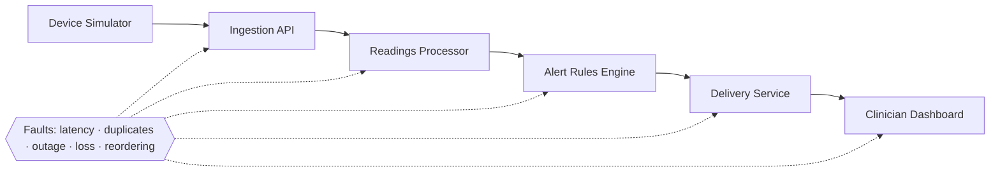
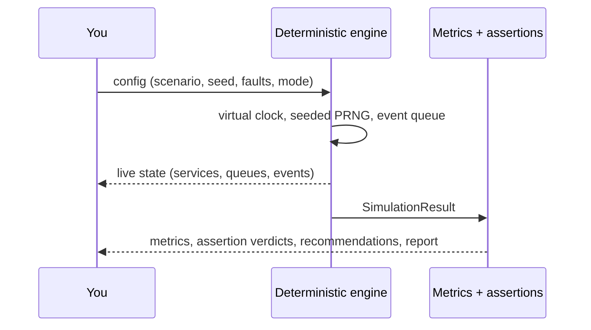

# CareChaos

**Chaos engineering for remote patient-monitoring software — in simulation.**

CareChaos lets you deliberately break a *synthetic* patient-monitoring data pipeline and see what happens to readings, alerts and recovery. It is inspired by Netflix's Chaos Monkey, but runs entirely locally on fictional data. It is a developer and educational tool, **not** a clinical decision-support system.

> ⚠️ Simulation only. All patients, devices and readings are fictional. A passing experiment does **not** establish clinical safety or regulatory compliance. See [docs/safety.md](docs/safety.md).

<!-- Screenshots: add docs/img/dashboard.png and docs/img/results.png -->


## The problem

Digital-health pipelines move readings from devices to clinicians through several services. Real networks drop, delay, duplicate and reorder messages, and services go down. Teams rarely test *what the downstream workflow does* in those moments: Is a delayed alert flagged stale? Is a duplicate alert shown twice? Do queued events survive an outage? How long until the backlog drains?

## Why chaos engineering

Failure is cheaper to learn about on purpose, in a sandbox, with a hypothesis and an assertion, than during an incident. CareChaos gives engineers a two-minute loop: configure a failure → run → inspect impact → verify recovery → export a report.

## How it works





* **Real engine first.** A deterministic, event-driven simulation with a virtual clock. The UI only chooses playback speed; tests run a full experiment in milliseconds. Same seed + config ⇒ identical results.
* **Every chart is engine output.** No hardcoded metrics.
* **Two modes.** *Resilient* (idempotency, bounded retries with backoff, durable queue and dead-letter redrive, stale-data flags, sequence-gap detection, newest-wins ordering) vs a documented *faulty reference* implementation, for side-by-side comparison on the same seed and volume.
* **Assertions can fail.** Each scenario states a hypothesis and checks it against what actually happened.

See [docs/architecture.md](docs/architecture.md), [docs/experiments.md](docs/experiments.md), [docs/metrics.md](docs/metrics.md), [docs/report-schema.md](docs/report-schema.md).

## Install and run

Requirements: **Node.js ≥ 22.5** (uses built-in `node:sqlite`; developed on Node 26) and npm. No API keys, Docker or external services.

```bash
npm install
npm run dev          # http://localhost:3000
```

Production:

```bash
npm run build
npm start
```

Environment (optional): `CARECHAOS_DB_PATH` — SQLite file for experiment history (default `data/carechaos.db`).

## Try it

1. Open `/` and press **Run demo** (alert-service outage, resilient mode). Watch the Delivery node go *unavailable*, the queue build, then *recovering → healthy*.
2. Open the *Faulty reference* mode toggle and run again to see the same fault lose alerts.
3. **Inject a failure** into a running experiment, or **Recover** a down service manually.
4. When it finishes, **View results**: assertions, baseline vs run vs other mode, timeline, recoveries, failure modes, recommendations, event tracing. Export **JSON** or **Markdown**.

### Creating an experiment

`/experiments/new` → choose a preset, set seed, event volume, reading interval, window, resilience mode and one fault (type, target, start, duration, intensity/delay). Validation tells you what to fix (for example when the outage would end after the window).

## Tests

```bash
npm run typecheck
npm test              # Vitest: unit + integration (engine, metrics, assertions, reports)
npm run test:e2e      # Playwright: builds the app and drives the real UI (npx playwright install chromium first)
```

## Project layout

```
src/engine/       simulation, faults, metrics, assertions, scenarios, reports (no React)
src/app/          Next.js App Router pages and API routes
src/components/   UI (topology SVG, charts, event stream, results)
src/lib/          browser simulation driver, SQLite persistence
tests/  e2e/      Vitest and Playwright
docs/             architecture, experiments, metrics, safety, report schema, sample report
```

## Limitations

* Simplified pipeline model; latencies are virtual-time model outputs, not performance benchmarks.
* One fault per experiment in the form (the engine supports several; live injection can add more).
* Alert thresholds are illustrative, not validated.
* Reading volume is capped at 2000 per experiment; the browser runs the engine, so very long runs at high speed use more CPU.
* History stores configs and replays them; it does not archive raw event logs. If you change engine logic, old experiments will replay with the new logic (`engineVersion` is recorded in reports).
* `node:sqlite` may print an experimental-feature warning on some Node versions.

## Roadmap

* Multiple simultaneous faults in the form, fault schedules, and chaos "game days".
* Network partition and clock-skew faults; rate limiting and backpressure.
* Archive raw logs for exact historical results across engine versions.
* Pluggable pipeline definitions and user-supplied processing code.
* CI mode: run scenario suites from the CLI and fail builds on assertion failures.
* Dark/light theme toggle and richer accessibility audits.

## Contributing

See [CONTRIBUTING.md](CONTRIBUTING.md). MIT licensed — see [LICENSE](LICENSE).
