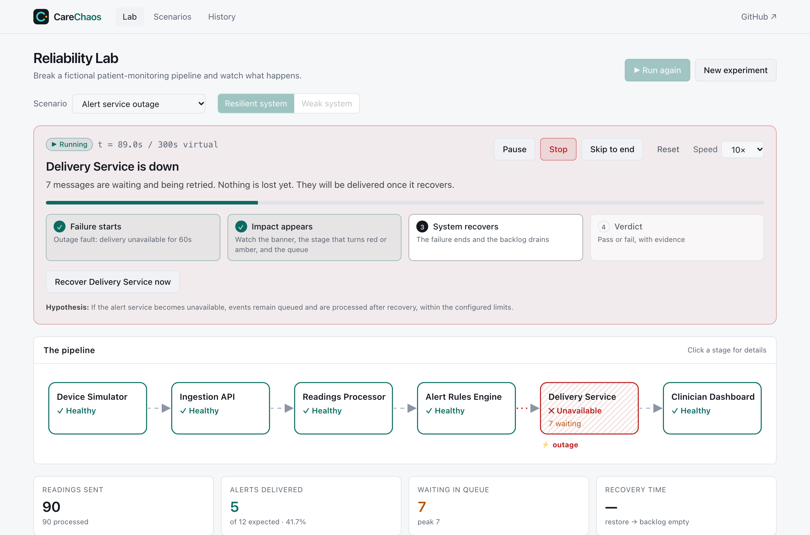
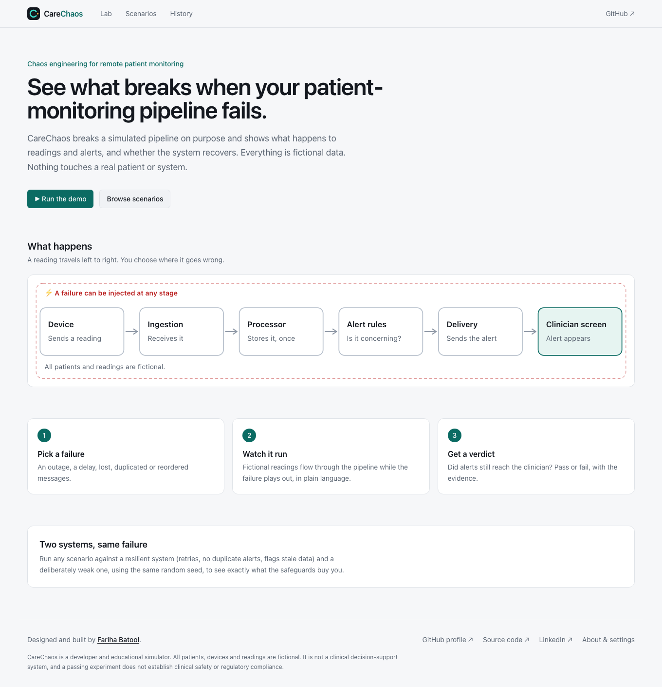
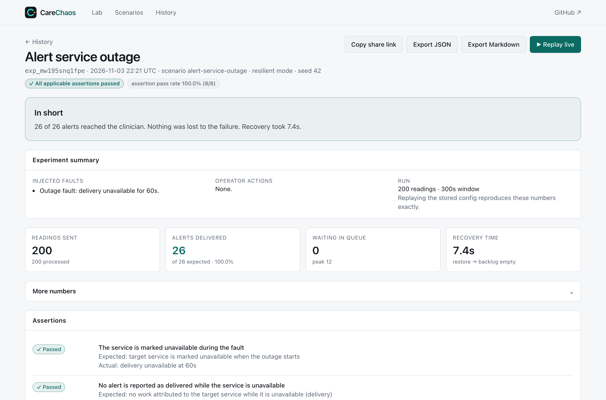
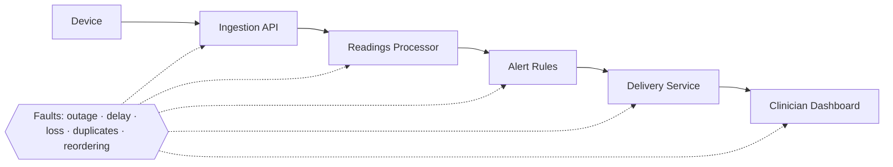
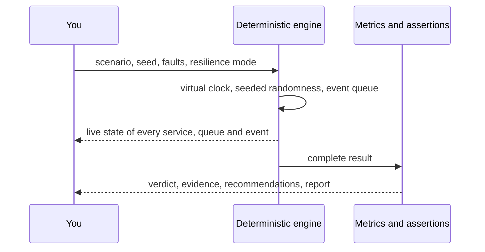

<div align="center">


# CareChaos

**Chaos engineering for remote patient-monitoring software, in simulation.**

Break a fictional patient-monitoring pipeline on purpose and see whether alerts still reach the clinician.

[](https://github.com/batool-fariha/carechaos/actions/workflows/ci.yml)
[](LICENSE)


**[Live demo](https://carechaos.vercel.app)** · [Docs](docs/) · [Report a bug](https://github.com/batool-fariha/carechaos/issues/new/choose)

</div>

> ⚠️ **Simulation only.** All patients, devices and readings are fictional. CareChaos is a developer and educational tool, not a clinical decision-support system. A passing experiment does **not** establish clinical safety or regulatory compliance. See [docs/safety.md](docs/safety.md).



## Contents

[Why](#why) · [Try it in 60 seconds](#try-it-in-60-seconds) · [How it works](#how-it-works) · [Features](#features) · [Quick start](#quick-start) · [Configuration](#configuration) · [Deploy](#deploy) · [CLI and CI](#cli-and-ci) · [Tests](#tests) · [Project layout](#project-layout) · [Documentation](#documentation) · [Limitations](#limitations) · [Roadmap](#roadmap) · [Contributing](#contributing)

## Why

Health-data pipelines move readings from devices to clinicians through several services. Real networks drop, delay, duplicate and reorder messages, and services go down. Teams rarely test *what the downstream workflow does* at those moments:

* Is a delayed alert flagged as stale?
* Is a duplicate alert shown to a clinician twice?
* Do queued events survive an outage, and how long until the backlog drains?

Chaos engineering answers questions like these by breaking things on purpose, in a safe place, with a hypothesis and an assertion. CareChaos gives you that loop in about two minutes: **configure a failure → run → inspect the impact → verify recovery → export a report.**

## Try it in 60 seconds

1. Open the **[live demo](https://carechaos.vercel.app)** and press **Run the demo**.
2. Watch the banner. It says in plain words what is happening: *"Delivery Service is down. 7 messages are waiting and being retried. Nothing is lost yet."*
3. Switch to **Weak system** and run it again. The same failure now loses alerts, because that system has no retry or buffer.
4. Open **View results** for the pass or fail verdict, the evidence behind it, and recommendations. Use **Copy share link** to send the run to someone.

| Landing page | Results |
|---|---|
|  |  |

## How it works





* **A real engine, not a mock-up.** A deterministic event-driven simulation with a virtual clock. The UI only chooses playback speed; a 300-second experiment runs in milliseconds in tests. Same seed and configuration produce identical results.
* **Every number comes from the engine.** Nothing on screen is hardcoded.
* **Two systems, same failure.** *Resilient*: idempotent processing, bounded retries with backoff, durable queue with dead-letter redrive, stale-data flags, sequence-gap detection, newest-wins ordering. *Weak*: a documented reference implementation without those safeguards.
* **Assertions can fail.** Each scenario states a hypothesis and checks it against what actually happened.

Details: [docs/architecture.md](docs/architecture.md).

## Features

| Area | What you get |
|---|---|
| Faults | Latency (5 / 15 / 60 s presets), duplicate delivery, outage (manual or timed recovery), packet loss (5 / 10 / 25 %), out-of-order delivery, recovery backlog with configurable drain rate |
| Scenarios | Seven ready-made experiments, each with hypothesis, initial conditions, expected behavior, assertions and relevant metrics |
| Lab | Plain-language narrator, guided four-step tracker, live pipeline view, live fault injection, manual recovery, pause / stop / reset / replay |
| Results | Assertion verdicts with evidence, baseline vs run vs other-mode comparison, timeline, recovery table, failure modes, evidence-based recommendations, per-event tracing |
| Reports | JSON ([schema 1.0](docs/report-schema.md)) and Markdown, generated from the completed run |
| Sharing | Copy a link to any result; Open Graph preview card |
| History | Per-browser history in SQLite locally or Postgres in production |
| Automation | Headless scenario runner with CI exit codes |
| Quality | 65 unit and integration tests, 21 Playwright end-to-end tests, automated accessibility checks (axe) |

## Quick start

Requirements: **Node.js ≥ 22.5** (uses the built-in `node:sqlite`; developed on Node 26) and npm. No API keys, Docker or external services.

```bash
git clone https://github.com/batool-fariha/carechaos.git
cd carechaos
npm install
npm run dev
```

Open <http://localhost:3000>. The landing page explains the idea and **Run the demo** opens the lab at `/lab`.

```bash
npm run build && npm start   # production build
```

### Create your own experiment

`/experiments/new` → choose a preset, then set seed, event volume, reading interval, window, resilience mode and up to four simultaneous faults (type, target service, start, duration, intensity or delay). The form explains each parameter and tells you what to fix if a combination is impossible, for example an outage that would end after the observation window.

## Configuration

All variables are optional.

| Variable | Purpose |
|---|---|
| `DATABASE_URL` / `POSTGRES_URL` | Store history in Postgres (Neon, Vercel Postgres, any provider). The table is created automatically. |
| `CARECHAOS_DB_PATH` | SQLite file used when no Postgres URL is set. Default `data/carechaos.db`. |
| `NEXT_PUBLIC_SITE_URL` | Public site URL for link previews. Default `https://carechaos.vercel.app`. |

Without any database variable on Vercel, history falls back to an ephemeral `/tmp` SQLite file; **Settings** tells you which storage is active and whether it persists.

## Deploy

One-click path: import the repo into [Vercel](https://vercel.com/new), add a Neon Postgres from the Vercel Marketplace (it sets `DATABASE_URL` for you), and deploy. Step-by-step: [docs/deployment.md](docs/deployment.md).

## CLI and CI

```bash
npm run scenarios                               # all scenarios, resilient mode
npm run scenarios -- --mode both --out reports  # also run the weak reference; write JSON and Markdown reports
npm run scenarios -- --scenario packet-loss,out-of-order --seed 7
```

The exit code is `1` if any **resilient** scenario fails an assertion (weak-mode runs are reference runs and never fail the suite) and `2` for bad arguments. [`.github/workflows/ci.yml`](.github/workflows/ci.yml) runs typecheck, unit tests, the scenario suite and the Playwright tests on every push.

## Tests

```bash
npm run typecheck
npm test                                   # Vitest: engine, metrics, assertions, reports, storage
npm run test:e2e                           # Playwright: builds the app and drives the real UI (npx playwright install chromium first)
TEST_DATABASE_URL=postgres://... npm test  # also exercises the Postgres adapter
```

## Project layout

```
src/engine/       simulation, faults, metrics, assertions, scenarios, reports (no React)
src/app/          Next.js App Router pages and API routes
src/components/   UI: pipeline view, charts, narrator, results
src/lib/          browser simulation driver, storage adapters, ownership, rate limiting
scripts/          scenario runner, sample report, screenshots
tests/  e2e/      Vitest and Playwright
docs/             architecture, experiments, metrics, report schema, API, security, deployment, safety
```

## Documentation

| Doc | Contents |
|---|---|
| [Architecture](docs/architecture.md) | Engine design, scheduler, determinism, how the app drives it |
| [Experiments](docs/experiments.md) | Fault semantics, outage and recovery rules, the seven scenarios |
| [Metrics](docs/metrics.md) | Every metric, its denominator, and loss classification |
| [Report schema](docs/report-schema.md) | Stable JSON report format, with a [sample](docs/sample-report.json) |
| [API](docs/api.md) | HTTP endpoints |
| [Security and privacy](docs/security.md) | Ownership model, rate limiting, what is stored |
| [Deployment](docs/deployment.md) | Vercel and Neon, environment variables |
| [Safety](docs/safety.md) | Scope and limits of what this tool can claim |

## Limitations

* A simplified pipeline model. Latencies are virtual-time outputs, not performance benchmarks.
* At most four faults per experiment. Events with an injected duplicate copy are excluded from latency assertions, because a copy bypasses the link fault.
* Alert thresholds are illustrative demo values, not validated clinical thresholds.
* Reading volume is capped at 2000 per experiment. The browser runs the engine, so very long runs at high speed use more CPU.
* History stores configurations and replays them rather than archiving raw event logs, so old experiments replay with the current engine logic (`engineVersion` is recorded in reports).
* The rate limiter is best-effort (in-memory per serverless instance). History ownership is an anonymous browser cookie, not an account.
* `node:sqlite` may print an experimental-feature warning on some Node versions.

## Roadmap

* "Sign in with GitHub" so history follows you across devices (needs an OAuth app; the storage layer is already owner-scoped).
* Fault schedules and chaos "game days".
* Network partition and clock-skew faults; rate limiting and backpressure in the model.
* Archive raw event logs for exact historical results across engine versions.
* Pluggable pipeline definitions and user-supplied processing code.
* Light/dark toggle and screen-reader testing beyond automated checks.

## Contributing

Issues and pull requests are welcome. Read [CONTRIBUTING.md](CONTRIBUTING.md) and the [Code of Conduct](CODE_OF_CONDUCT.md) first. Report security problems privately, as described in [SECURITY.md](SECURITY.md).

## Author

Designed and built by **[Fariha Batool](https://www.linkedin.com/in/fariha-batool/)** · [GitHub](https://github.com/batool-fariha) · Licensed under the [MIT License](LICENSE).
