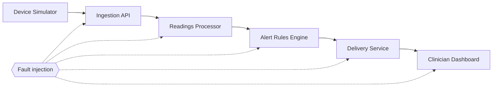
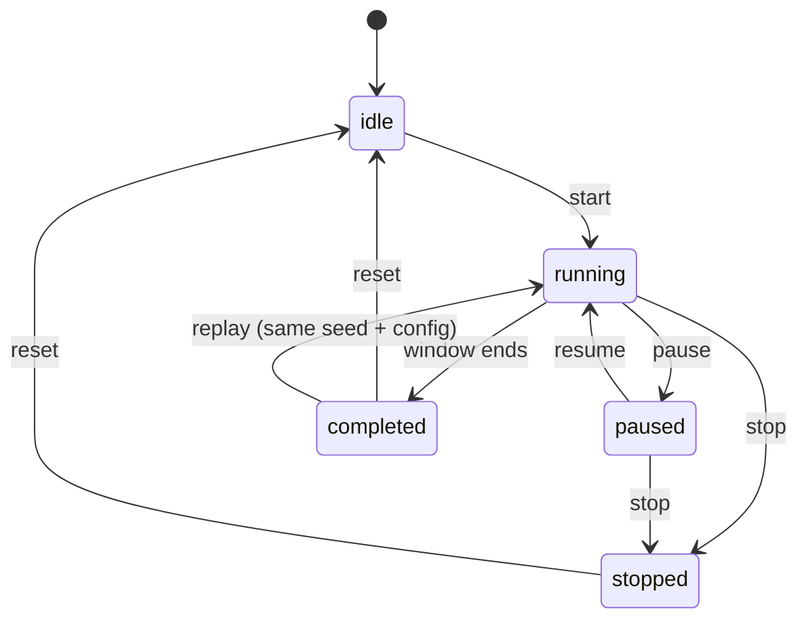

# Architecture

CareChaos has two halves joined by a small, serializable contract: an **engine** that knows nothing about the UI, and a **Next.js app** that drives and displays it.

## Engine (`src/engine`)

* **Virtual clock.** Integer milliseconds; the UI chooses how fast virtual time advances, tests run a 300 s experiment in a few milliseconds.
* **Scheduler.** A binary heap ordered by `(time, priority, insertion order)`. Priorities: fault start/end (-1) → pipeline activity (0) → operator interventions (1) → sampling (2) → end of run (3).
* **Services.** Every stage is a `Service` with an inbound queue, a worker (rate = capacity), health (`healthy | degraded | unavailable | recovering`), retry holds, a dead-letter queue, counters and a transition log. Health is *derived* from engine state in one function (`refresh`), so the UI cannot report recovery that has not happened.
* **Hops and faults.** An event moves service-to-service through `send` → `arrive`. Link faults (latency, loss, duplicate, out-of-order) are applied in `send` for the *target* service; outages are applied in `arrive` / the worker.
* **Resilient vs faulty.** One `mode` flag toggles: idempotency by event ID, sender retries with exponential backoff (1,2,4,8,8,… s, max 8), durable queues with dead-letter redrive on recovery, stale-data flags, sequence-gap tracking, and “newest wins” ordering. Faulty mode drops on unavailable targets, loses in-memory queues on a crash, accepts duplicates, and lets older readings overwrite newer ones.
* **Determinism.** All randomness comes from `makeRng(seed, label)` streams (generator; one per fault in start order). Results are independent of how the clock is stepped. Operator actions (manual recovery, live fault injection, stop) are recorded as `interventions`, so a live session is replayed exactly from `config` alone.
* **Evaluation.** `computeMetrics` and `evaluateAssertions` read only the `SimulationResult`. Assertions return `passed | failed | not_applicable` with expected/actual text and supporting event IDs.

## App (`src/app`, `src/components`)

* `useSimulation` runs the engine in the browser at a chosen speed; the dashboard and the live experiment page share the `Runner` component.
* Experiment history stores **configuration only** (plus a verdict/summary recomputed server-side). Results pages re-run the engine from the stored config, which is why exports always match the run.
* Persistence: `node:sqlite` (`src/lib/db.ts`), `CARECHAOS_DB_PATH` (default `data/carechaos.db`). If storage fails the simulator still works and the UI says so.
* UI primitives in `src/components/ui.tsx` follow shadcn/ui conventions (variants, tokens) but are hand-written to avoid pulling Radix into an MVP.

## Narrator and guide

`src/lib/narrate.ts` turns engine state into one plain-language sentence (for example “Delivery Service is down. 7 messages are waiting…”). `GuideSteps` tracks four stages (failure starts, impact appears, system recovers, verdict) from the run's real timeline. Neither adds any state of its own.

## Ownership and storage

Experiments are stored by a storage adapter (`src/lib/db.ts`: SQLite or Postgres) and scoped to an anonymous `cc_owner` cookie (`src/lib/owner.ts`). Reading by ID is public so results can be shared; writes are owner-only and rate limited (`src/lib/rateLimit.ts`). See [security.md](security.md).

## Data flow of one event

`generated → in_transit → (delayed) → received → queued → processed → alert_generated → delivered`, or `dropped` / `rejected_duplicate` / `failed`. Every transition is stored on the event (`transitions`) and in the global log with the component and an explanation.
