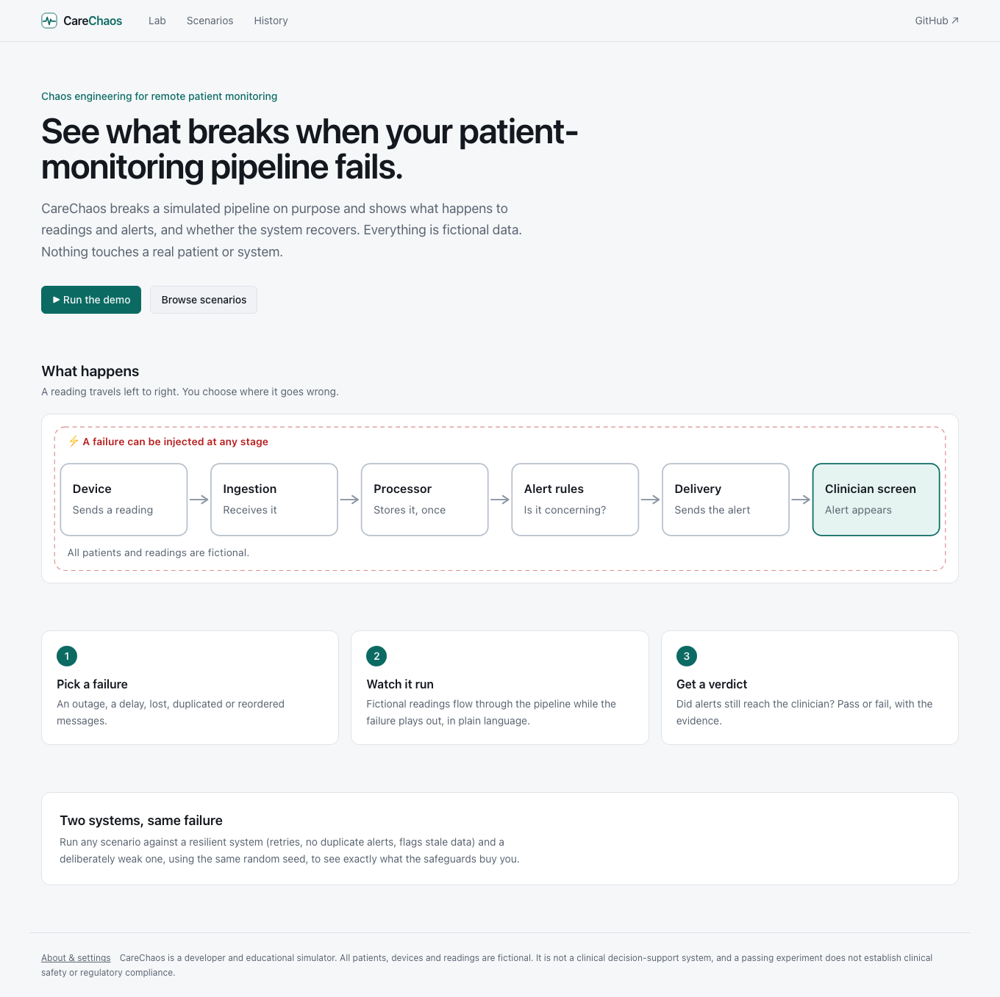
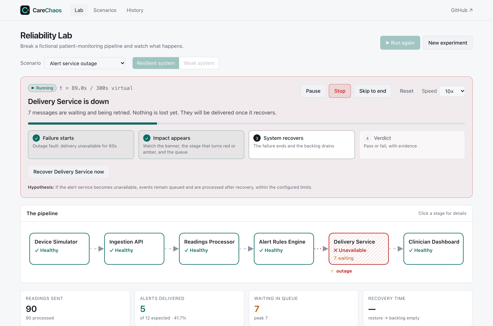

# What happens to a patient alert when the delivery service dies for 60 seconds?

*A walk through one CareChaos experiment. Everything below is simulated: the patients, the readings and the numbers are fictional, and nothing here says anything about clinical safety.*

Remote patient monitoring has a boring failure mode that worries me more than most dramatic ones: a link in the chain goes down for a minute, nobody notices, and an alert that should have reached a clinician never does.

So I built [CareChaos](https://carechaos.vercel.app), a small simulator that breaks a fictional monitoring pipeline on purpose and shows what happens. This post follows a single experiment from it.

## The setup

A device sends a reading every second. Each reading passes through ingestion, a processor, an alert-rules stage and a delivery service before it shows up on a clinician's screen. About one reading in eight crosses an (illustrative) rule and should raise an alert. In a run of 200 readings, 26 of them do.



The failure: **the delivery service goes down at 60 seconds and comes back at 120.** That is the scenario called *Alert service outage*.

## Run it twice, same seed

The part I find most useful is running the same failure against two systems with the same random seed, so the only difference is the safeguards.

| | Resilient system | Weak system |
|---|---|---|
| Alerts expected | 26 | 26 |
| Alerts delivered | **26** | **14** |
| Alerts lost | 0 | **12** |
| Peak backlog | 12 | 1 |
| Reported recovery time | 7.4 s | 2 s |
| Assertions passed | 8 of 8 | 5 of 8 |

**The weak system lost 12 alerts, and nothing in its dashboard would have told anyone.** It had no retry and no buffer, so every alert that reached the dead service was simply dropped. Each drop is recorded in the simulator with a reason (`target_unavailable`), but a real system without those safeguards would just be quietly missing alerts.

Notice the "recovery time" row. The weak system reports a *faster* recovery, 2 seconds against 7.4. That looks better right up until you notice why: it recovered quickly because there was no backlog to clear. The alerts were already gone. A recovery metric on its own can flatter a system that lost data, which is why CareChaos always reports it next to what was lost.

## What the resilient system did

It did not get away free either. The 12 alerts that arrived during the outage were held and retried with exponential backoff (1, 2, 4, 8 seconds, capped). Three of them ran out of retries before the service came back and landed in a dead-letter queue. When the service was restored, those three were redriven along with the rest, and all 26 alerts were delivered.



But "delivered" is not the same as "on time". The slowest alert reached the dashboard **57 seconds** after the reading was taken, and seven of the 26 alerts took more than 30 seconds. Whether 57 seconds is acceptable is a clinical question the simulator cannot answer. What it can do is make that number impossible to overlook, so someone can decide on purpose.

## Why I like asserting instead of eyeballing

Each scenario states a hypothesis and checks it against what actually happened:

- The service is marked unavailable while the fault is active.
- No alert is reported as delivered while it is down.
- Queued events are visible.
- Events are processed after recovery.
- Recovery completes within the limit.
- Nothing is lost for any reason other than the fault.

These are real assertions over the event log, so they can fail. The weak system fails three of them (queue visibility, post-recovery delivery and unexpected loss), and each failure comes with the event IDs that prove it.

## Try your own failure

You can run all of this in the browser at [carechaos.vercel.app](https://carechaos.vercel.app) with no setup. Press *Run the demo*, then flip to *Weak system* and run it again.

If you want to test your own pipeline numbers, describe your stages' capacities, retry policy and alert rules in a small JSON file and run it from the command line or from CI:

```bash
npm run carechaos -- run --scenario alert-service-outage --mode both
npm run carechaos -- run examples/carechaos.json --junit results.xml
```

There is also a *game day* scenario that stacks five failures in one run (a slow processor, duplicate deliveries, a delivery outage, packet loss and a processor outage), for rehearsing a bad afternoon instead of a single fault.

## What this is not

It is a model, not a measurement. The latencies are virtual-time outputs, the alert thresholds are illustrative demo values, and a green run proves only that a modeled behavior held under modeled conditions. It is for engineers who build these systems to ask "what happens if…?" cheaply and early.

Source, docs and the sample report are on [GitHub](https://github.com/batool-fariha/carechaos). Feedback and scenarios are welcome.

*Fariha Batool*
